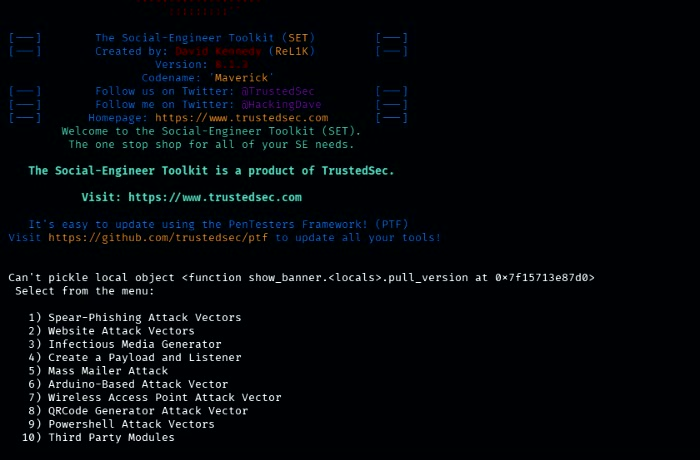

# Lab Walkthrough

> Nota: Todas as credenciais e dados exibidos neste walkthrough são fictícios e foram gerados em ambiente de laboratório isolado.

This section documents the lab at a high level. Only screenshots that do not expose credentials or provide an operational credential-capture walkthrough are included. From the 13 images reviewed, one suitable overview image was selected; the remaining source images are not copied into this repository.

## 1. Main menu of SEToolkit

*This cropped overview identifies SEToolkit and shows its top-level menu categories. It gives context for the lab without documenting module configuration or execution.*

## 2. Social-Engineering Attacks option

[📸 INSERIR PRINT AQUI: Menu Social-Engineering Attacks]
*View of the `Social-Engineering Attacks` section, highlighting the tooling used in the academic exercise.*

*Source images showing detailed attack-vector and module menus were omitted to avoid publishing an operational walkthrough.*

## 3. Website Attack Vectors

[📸 INSERIR PRINT AQUI: Website Attack Vectors]
*Overview of the `Website Attack Vectors` menu relevant to credential harvesting and cloning workflows.*

*The source images for this stage were not included; use only a sanitized, high-level image if this section is later completed.*

## 4. Credential Harvester / Site Cloner

[📸 INSERIR PRINT AQUI: Credential Harvester e Site Cloner]
*Module context for credential harvesting and the site-cloning option used in the lab.*

*Screenshots showing detailed module selection or setup were omitted.*

## 5. Network configuration in the isolated lab

[📸 INSERIR PRINT AQUI: Configuração de rede local isolada]
*Local network details and configuration used to keep the exercise isolated in the controlled environment.*

*The source images contain environment details and are not included. Do not publish host addresses or other lab identifiers unless they have been reviewed and intentionally sanitized.*

## 6. Cloned page in the lab

[📸 INSERIR PRINT AQUI: Página demonstrativa no laboratório]
*Example of a cloned or replicated site used in a controlled local environment as part of the lab demonstration.*

*The source image of a look-alike sign-in page was omitted to avoid redistributing a phishing-style page image.*

## 7. Captured credentials in the terminal

[📸 INSERIR PRINT AQUI: Saída sanitizada do terminal]
*Terminal view associated with the lab capture process, illustrating the evidence recorded in the authorized environment.*

*The source terminal screenshots exposed candidate usernames, passwords, and authentication parameters. They were not copied into this repository. Do not add them unless all sensitive values are irreversibly redacted.*

## 8. Closure and cleanup

[📸 INSERIR PRINT AQUI: Encerramento e limpeza do laboratório]
*Final shutdown and cleanup of the isolated lab environment after the exercise is complete.*

## 9. Social engineering, MitM phishing, and C2: defensive context

Classic social-engineering demonstrations, such as those documented for SEToolkit here, focus on the user's interaction with a deceptive message or look-alike page. A different category is adversary-in-the-middle (AiTM, also called MitM) phishing, in which a reverse proxy is placed between a user and a legitimate service. At a conceptual level, this can expose authenticated session material and may undermine some forms of MFA when the authentication flow is not phishing-resistant. This section does not describe how to build, configure, or operate such infrastructure.

Tools publicly associated with AiTM research, including Evilginx2 and Modlishka, are mentioned only to identify the threat category. Their names are not an endorsement or an instruction to use them. The defensive takeaway is that MFA is not equally resistant to phishing in every form: organizations should prefer phishing-resistant authentication such as passkeys or FIDO2/WebAuthn security keys where supported, monitor for suspicious sessions, and train users to verify origins and report unexpected authentication requests.

C2 frameworks serve another purpose: they are generally used after an endpoint has been compromised to support remote tasking and post-compromise activity. They are therefore distinct from both user-facing social engineering and AiTM credential/session interception. For this academic report, all three are discussed only to clarify defensive concepts; no operational steps or configuration details are included.

## Notes

- The source collection included repeated menu views, module/setup screens, a failed cloning attempt, a look-alike sign-in page, terminal capture output, and explanatory browser content. Only the non-sensitive main-menu overview is included.
- Replace remaining `[📸 INSERIR PRINT AQUI: ...]` markers only with lab-produced evidence from an authorized, isolated environment, after checking for credentials, personal information, authentication/session parameters, and operational details.
- Never include real credentials or personal identifiers in the repository.
